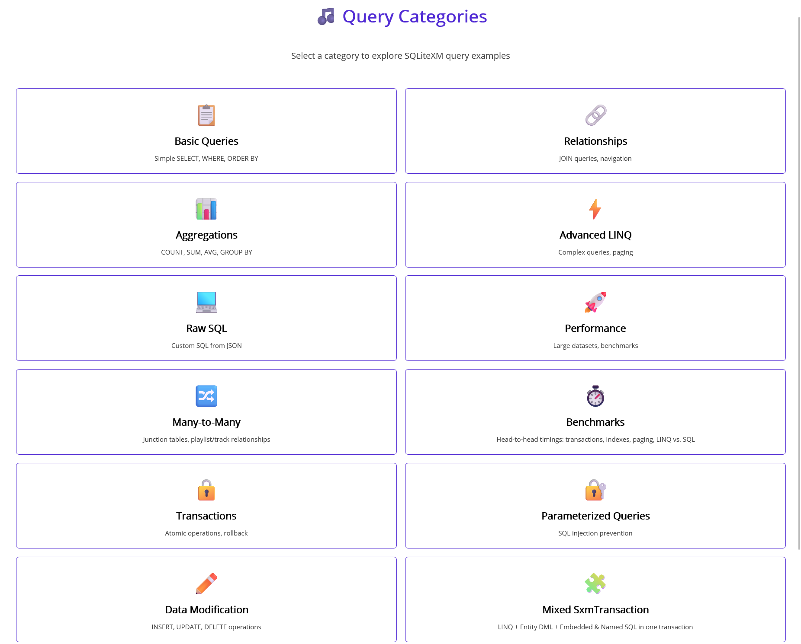

# SQLiteXM for .NET MAUI

[](https://www.nuget.org/packages/SQLiteXM/)   [](https://github.com/AnthonySerpico/SQLiteXM-for-.NET-MAUI/blob/master/Docs/README.md)   [](https://github.com/AnthonySerpico/SQLiteXM-for-.NET-MAUI/releases) [](https://github.com/AnthonySerpico/SQLiteXM-for-.NET-MAUI/actions/workflows/dotnet-tests.yml)


SQLiteXM is a high-performance, entity-first ORM for SQLite designed specifically for .NET MAUI applications.

---

## Why SQLiteXM?

We asked ourselves: “What would a deliberately designed SQLite persistence layer for modern .NET/MAUI 
applications look like—one that supports SQL and LINQ while still providing convenient entities, schema 
evolution, transactions, mapping, persistence methods, and UI binding?”

The result is SQLiteXM.

| Capability | SQLiteXM |
|------------|----------|
| Designed specifically for .NET MAUI + SQLite | ✅ |
| AOT/IL Trimming Safe — works with MAUI's default Release trimming, no linker configuration needed ([details](#aot-trimming)) | ✅ |
| Thread-safe, idempotent database startup, callable from any entry point | ✅ |
| LINQ query support | ✅ |
| Raw SQL Support | ✅ |
| Automatic entity-to-table mapping | ✅ |
| Built-in schema evolution | ✅ |
| SQLite PRAGMAS are first-class initialization options | ✅ |
| Multiple SQLite Database Support | ✅ |
| Full Transaction Support — explicit and ambient transaction patterns | ✅ |
| Handles mobile lifecycle events — app suspend/resume | ✅ |
| Entities are MAUI binding-ready with INotifyPropertyChanged support | ✅ |
| Async-first design — supports non-blocking UI patterns | ✅ |
| Minimal configuration — no migration files, no DbContext setup | ✅ |
| Automated Test Coverage | 760+ tests |

---

## 📦 Installation

```bash
dotnet add package SQLiteXM
```

Or install via the [NuGet Package Manager](https://www.nuget.org/packages/SQLiteXM/)

---

## 📖 Documentation

See the **[Documentation Guide](https://github.com/AnthonySerpico/SQLiteXM-for-.NET-MAUI/blob/master/Docs/README.md)** to find the right guide for where you are in your project.

---

## 🎮 Try SQLiteXM with the Query Gallery Demo

📥 **Want to see SQLiteXM in action?** Download the pre-built **[Query Gallery Demo](https://querygallerydemo.s3.us-east-1.amazonaws.com/QueryGalleryDemo_Windows.zip)** application. This is a ready-to-run MAUI Windows application that showcases SQLiteXM through working query examples organized into 13 categories. This demo runs completely self-contained. Simply extract the ZIP file on Windows and run `QueryGalleryDemo.exe` to explore.

**Features:**
- ✅ 125+ working query examples across 13 categories - LINQ, SQL, Bulk Insert, Benchmarks, and more.
- ✅ Live code execution with performance metrics
- ✅ Realistic music database (~25,000 records) 


<details>

<summary>🖼️ <strong>Preview Query Gallery Screenshot</strong></summary>

<p align="center">
  <a href="https://raw.githubusercontent.com/AnthonySerpico/SQLiteXM-for-.NET-MAUI/master/Docs/images/query-gallery-categories.png">
    
  </a>
  <br />
  <sub><em>Click the image to view full size</em></sub>
</p>

</details>

<details>
<summary>📖 <strong>Query Gallery Categories</strong></summary>

- ✅ Basic Queries 10 - simple select, where, order by
- 🔗 Relationships 8 - join queries, navigation
- 📊 Aggregations 10 - count, sum, group by, avg
- 📦 Advanced LINQ 11 - complex queries, paging
- 🎯 Raw SQL 15 - direct SQL execution
- 📈 Performance 9 - large data sets, benchmarks
- 🔄 Many-to-Many 8 - junction tables, relationships
- 💾 Transactions 6 - atomic operations, rollback
- ⚡ Parameterized Queries 6 - prevent SQL injection
- 💾 Data modification 8 - insert, update, delete examples
- 🧩 Mixed Context 10 - LINQ, named SQL, embedded SQL and entity DML in one transaction
- ⏱️ Benchmarks 11 - side-by-side timing of competing data-access strategies
- 🔗 LoadWith Eager Loading 15 - demonstrate eager loading of related entities
</details>


Want more details? See the [Query Gallery Demo](https://github.com/AnthonySerpico/SQLiteXM-for-.NET-MAUI/blob/master/Docs/querygallery-demo.md)

---

## 🎯 SQLiteXM Quick Start (4 Minutes)

### 1. Define Your Entities

Create classes that inherit from `SxmEntity`:

```csharp
using SQLiteXM;

[Table(IsColumnAttributeRequired = false)]
public class User : SxmEntity
{
    public string? Name { get; set; }

    public int Age { get; set; }

    public DateTime CreatedAt { get; set; }

    public DateTime? LastLogin { get; set; }

    [Index]
    public string? Email { get; set; }
}

[Table(IsColumnAttributeRequired = false)]
public class Post : SxmEntity
{
    public string? Title { get; set; }

    public string? Content { get; set; }

    [ForeignKey(nameof(User))]
    public long UserId { get; set; }
}
```

#### What's happening?

* `SxmEntity` marks the class as a database-mapped entity
* `[Table]` defines schema behavior for the entity
* `[Index]` declares a database index on the property
* `[ForeignKey]` defines relational constraints between entities
* A nullable property such as `DateTime? LastLogin` maps to a column that allows `NULL`

The schema is created when the database is initialized with `StartInitialization(...)` (step 3).

---

### 2. Create `SqlStatements.json` File

Place this file in `Resources/Raw` (Build Action: `MauiAsset`):

```json
{
  "databases": [
    {
      "database": "MyAppDatabase",
      "isDefault": true
    }
  ]
}
```

#### What's happening?

* Defines the SQLite database configuration for the application
* `database` specifies the SQLite database name
* `isDefault` assigns the default database for entities without an explicit database assignment
* The configuration is loaded during initialization to establish database connections and schema management

---

### 3. Initialize SQLiteXM

Once your entities and database configuration are defined, you're ready to initialize the database. 

```csharp
    // Create an array containing all the entities used by your application
    Type[] applicationEntities = new Type[]
    {
        typeof(User), 
        typeof(Post)
    };

    // Open the SqlStatements.json configuration file from the application package
    Stream sqlStatementsStream = await FileSystem.OpenAppPackageFileAsync("SqlStatements.json");

    // Start database initialization in the background
    // SQLiteXM takes ownership of 'sqlStatementsStream' and ensures proper disposal.
    SxmDatabase.StartInitialization(sqlStatementsStream, databaseOptions: null, applicationEntities);
```

Call `SxmDatabase.StartInitialization(...)` once during application startup. A good place is 
in MauiProgram.cs right after calling `MauiApp.CreateBuilder()`. `StartInitialization` returns immediately 
without blocking - initialization runs in the background.

---

### 4. Verifying Database Initialization Has Completed

Before the *first* use of the database, anywhere in your app, call:

```csharp
await SxmDatabase.EnsureReadyAsync();
```

`EnsureReadyAsync` only needs to be called once. It waits for the database initialization task started by 
`StartInitialization` to complete, guaranteeing that the database is fully initialized and ready for use.

---

### 5. Start Reading and Writing Data

Once initialization is complete, SQLiteXM is ready for normal 
application use. You can create and save entities, query and modify data using LINQ or 
SQL, and begin using transactions.

```csharp
// 'User' inherits from SxmEntity and is automatically mapped to a database table
User user = new User
{
    Name = "Alice",
    Age = 0,
    Email = "alice@example.com",
    CreatedAt = DateTime.UtcNow
};

// Insert 'user' into the database
// 'Age' is initially set to 0; the record is updated below.
await user.SaveAsync();

await using (SxmTransaction ctx = new SxmTransaction())
{
    // LINQ — query the user to modify.
    User? existingUser = await ctx.GetTable<User>().FirstOrDefaultAsync(u => u.Name == "Alice");

    if (existingUser != null)
    {
        // Embedded SQL — execute SQL within the same transaction.
        // Values are passed as parameters rather than built into the SQL text.
        Dictionary<string, object?> loginParms = new Dictionary<string, object?>
        {
            ["LastLogin"] = DateTime.UtcNow,
            ["Name"]      = "Alice"
        };

        await ctx.RunStatementAsync(
            "UPDATE User SET LastLogin = @LastLogin WHERE Name = @Name", loginParms);

        // Entity DML — persist the change.
        // Uses the active transaction.
        existingUser.Age = 25;
        await existingUser.SaveAsync();
    }

} // <-- Automatically commits transaction on dispose if no errors occurred
```

#### What's happening?

* `SaveAsync()` inserts a new entity or updates an existing entity based on its primary key
* `SxmTransaction` starts a new transaction scope for database operations
* All database operations within the transaction participate in the same commit scope
* LINQ executes against the database and returns an entity instance, or `null` when no row matches
* `RunStatementAsync()` executes embedded SQL within the active transaction, binding values as
parameters rather than concatenating them into the SQL text
* Entity instances can be modified and persisted using the same `SaveAsync`


---

## 🧪 Testing

over **760 tests**, run against both **.NET 8** and **.NET 10** (1,530+ test executions)

### Performance Benchmarks (from test suite)

| Operation | Time | Details |
|-----------|------|---------|
| 10,000 row insert (transacted) | 0.45s | Using explicit transaction |
| 10,000 row bulk insert | 0.25s | Transacted bulk insert |
| 50,000 row query | 14ms | With index |
| Complex LINQ (20K rows) | 12ms | Joins + filters |
| 100 concurrent writes | 1.2s | Thread-safe operations |

Benchmark results are environment-dependent and are provided as indicative results from the project's test suite rather than universal performance guarantees.

### Test Coverage

<details>

<summary>📋 <strong>View the Full Test Coverage Breakdown</strong></summary>

<p> </p>   

| Test  | Count | Focus |
|------------|------:|------------|
| `AdvancedLinqTests` | 12 | GroupBy, joins, set operations, deferred execution, projections |
| `BulkInsertTests` | 70 | Three bulk-insert entry points (`SxmSql`, `SxmTransaction`, LINQ extension) across shared behavior theories plus per-API transaction semantics |
| `BulkLinqOperationsTests` | 12 | LINQ bulk update/delete, predicates, transaction scoping, chaining |
| `ColumnRenameTests` | 10 | `[Rename]` processing, multi-step rename chains, data preservation |
| `ConcurrencyTests` | 11 |  Concurrent entity and data access scenarios |
| `ConcurrencyMultiDatabaseTests` | 2 |  Concurrent access across multiple databases |
| `ConnectionManagerWorkerTests` | 7 | `RunWorkersAsync` concurrent connection workers: shared-connection locking, lock hand-off, and wait timeouts |
| `DatabaseOptionsValidatorTests` | 78 | `SxmDatabaseOptions` validation rules: numeric ranges, undefined enum values, folder-override paths, configuration-combination warnings, and the `ValidationResult` contract. Pure in-memory - no database required. Resets the shared `EnableConnectionPooling` / `EnableLogging` / `DefaultTimeout` statics around each test |
| `DatabaseOptionsEffectTests` | 22 | Proves the configured options actually reach SQLite: `journal_mode`, `synchronous`, `foreign_keys`, `temp_store`, `cache_size` (negative-KB encoding), `busy_timeout` and `wal_autocheckpoint` PRAGMA round-trips, plus `OnConnectionOpened` / `OnConnectionClosed` interceptor invocation and ordering. Most PRAGMAs are per-connection, so they are read from inside an interceptor on the very connection SQLiteXM configured; WAL is additionally verified from an independent connection because it is persisted in the database file. Re-initializes SQLiteXM per test and restores the standard test configuration afterwards |
| `DecimalComparisonTests` | 14 | Decimal value comparison behavior in queries |
| `DropTableTests` | 24 | `SxmSql.DropTableAsync`: non-existent and repeated drops, refusal when dependent tables exist (naming the blocking table), child-first drops, and null/whitespace identifier validation |
| `DualForeignKeyNavigationTests` | 18 | Navigation across two foreign keys on the same entity |
| `EntityCrudTests` | 9 | `SaveAsync` insert and update, `DeleteAsync`, ID population and uniqueness, and round-trips of all supported data types |
| `EntityInitializationTests` | 13 | Table creation, type mapping, indexes, FKs, triggers, thread safety |
| `EntityMappingTests` | 4 | `MapProperties`, `MapAndSaveAsync`, null/mismatch handling |
| `EntityMigrationTests` | 17 | Adding columns (nullable, defaulted, NOT NULL), sequential and concurrent migrations |
| `FailFastTests` | 5 | Early validation on registration and entity construction |
| `GuidConsistencyTests` | 33 | `Guid` values stored and read back identically through every path (entities, LINQ, bulk insert, direct SQL), including nullable `Guid`, `synchId`, LINQ filters, the `TEXT` override, and raw SQL parameters |
| `InitializationPatternTests` | 11 | `SxmDatabase.StartInitialization` + `EnsureReadyAsync`, idempotency, failure propagation |
| `LargeSchemaInitializationBenchmarkTests` | 1 | Wall-clock measurement of first-run and migration-run initialization over a 75 x 50 schema (no pass/fail threshold) |
| `LinqContextTests` | 7 | Where, OrderBy, Select, FirstOrDefault, Count |
| `LinqQueryDocumentationTests` | 49 | Every LINQ example in the documentation, executed against seeded customer and order data |
| `LinqReadFailureTests` | 9 | A failed LINQ read rolls back the transaction: earlier writes discarded, later writes skipped, commit refused, rollback resets, and nested transactions share the failure |
| `LinqTransactionTests` | 6 | LINQ visibility across commit/rollback, deferred operations, isolation |
| `LoadWithTests` | 35 | Eager loading via `LoadWith` navigation paths |
| `MixedUnitOfWorkTests` | 5 | Entity writes, LINQ inserts, and raw SQL sharing one transaction: commit on dispose, rollback, joining an ambient transaction, and skipping writes after a fault |
| `MultiDatabaseLinqTests` | 18 | Per-database query contexts, aggregates, joins, projections |
| `MultiDatabasePerformanceTests` | 12 | Bulk, scale, and concurrency benchmarks; update-path correctness, transaction-batching speedup ratio, and throughput reporting |
| `MultiDatabaseTests` | 11 | Multiple databases in `statements.json`, entity routing, per-database transactions |
| `NamedStatementTests` | 41 | Statements resolved from `statements.json`: named vs. positional parameters, select/insert/update/delete, triggers, and unknown or invalid statement names |
| `NullHandlingTests` | 28 | Null properties stored as SQL `NULL` across insert, update, bulk insert, and read-back; null vs. empty string, empty blob, and default value |
| `RunStatementTests` | 18 | The `RunStatementAsync` overload matrix |
| `SchemaEvolutionTests` | 29 |
| `SharedConnectionTests` | 7 | Shared connection locking, timeouts, multi-caller safety |
| `SupportedDataTypesStorageTests` | 50 | Storage of every supported data type and its round-trip behavior |
| `SxmExceptionContractTests` | 9 | `SxmException` contract: `ErrorCode` and `Data["sxmErrorCode"]`, `Context`, exception filters, and wrapped vs. direct throws |
| `SxmTransactionBehaviorTests` | 30 | Every behavior in the Advanced Transaction Processing guide: commit or rollback on dispose, `IsFaulted`, your own exceptions vs. SQLiteXM failures, set-up failures, cancelled reads and writes, skipped writes, staged commits, nested and different-database transactions, uncommitted-work visibility, and use after disposal |
| `TransactionPatternTests` | 14 | The five transaction patterns from `Docs/application-lifecycle.md`: mixed operations, fault behavior, fault recovery, multiple commits, all-operation-type conformance |
| `TransactionTests` | 7 | Commit/rollback, atomicity, ambient transactions, nested-create rejection |
| `UpdateSetTests` | 10 | `SxmUpdateSet<T>` edge cases behind `Set().UpdateAsync()`: same column set twice, null assignment, multiple distinct columns, no-match predicates, expression-valued setters, mixed value/expression chains, and builder immutability. Several are characterization tests that record current behavior rather than a pre-specified contract |

</details>

---

## 🛠️ Requirements

- .NET MAUI Project

**Platforms:** iOS, Android, macOS, Windows (any .NET MAUI supported platform)

---

<a id="aot-trimming"></a>
## ✂️ AOT and IL Trimming Safe — Out of the Box

.NET MAUI trims your app in Release builds, and AOT-compiles it on iOS and Mac Catalyst. Reflection-based ORMs 
often break here: entity properties are trimmed away and mappings fail at runtime — but only on a device, never 
in Debug. The usual fix is to sprinkle `[Preserve]` or `[DynamicDependency]` attributes on your entities, add a 
`TrimmerRootDescriptor.xml`, or turn trimming off. That work lands on you.

SQLiteXM removes that burden:

- **Zero trim/AOT analyzer warnings.** SQLiteXM is built with `IsTrimmable` and `IsAotCompatible` and compiles 
  cleanly under the .NET trim and AOT analyzers.
- **Your entities are preserved automatically.** Every SQLiteXM API that accepts an entity type is annotated with 
  `DynamicallyAccessedMembers`, so the trimmer keeps your entity classes intact without any attributes, linker 
  files, or project changes on your side.
- **Works with MAUI's defaults.** Create a MAUI project, add SQLiteXM, define your entities, build in Release. 
  Nothing to configure. Verified against MAUI's default Release trimming on .NET 8 and .NET 10.

As with any MAUI project, run your Release build on a device or emulator before shipping — Debug builds do not 
trim, so that is the only place trimming behavior can be observed.

---

## 📄 License

MIT License - see [LICENSE](./LICENSE.txt) for details.

---

## 🙏 Acknowledgments

- SQLite provider via **[Microsoft.Data.Sqlite](https://github.com/dotnet/efcore)** (MIT License)
- LINQ support via **[LinqToDB](https://github.com/linq2db/linq2db)** (MIT License)

Inspired by **Entity Framework Core**, **Dapper**, and **SQLite-net**

---

**Made with ❤️ for the .NET MAUI community**
